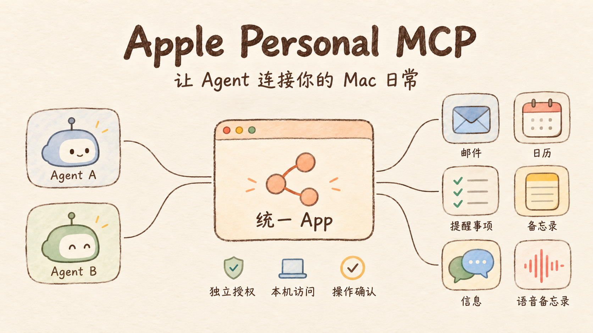

# Apple Personal MCP



统一的本机原生 App，连接多个 Agent 与 macOS 应用。Swift 宿主访问系统应用，每个 Agent 通过 App 内附的原生 stdio 入口连接同一个 XPC 服务。不使用 Docker、npm 或 Node。

当前开发版0.4.0已实现多Agent独立授权、并发调度、六应用读取、日历/提醒/备忘录写入、信息官方发送及语音后台任务。当前Mac已验证日历、提醒、笔记正文、信息历史、已有录音音频和一份原始转写全文。[多Agent记录](docs/validation/2026-10-26-multi-agent.md)、[六应用读取记录](docs/validation/2026-10-26-six-app-reads.md)区分实测、合成覆盖和未完成项；[首阶段邮件记录](docs/validation/2026-10-26-framework-mail.md)保留历史结果。

原生管理窗口采用黑灰深色界面，提供概览、Agent、应用和活动四个页面；六应用图标从本机应用读取。状态在打开窗口和手动刷新时检查，系统访问与 Agent 权限分别展示；最近活动只显示工具、Agent、状态、时间和耗时，不显示私人正文。[界面验证记录](docs/validation/2026-10-27-native-dashboard.md)。

## 构建与启动

当前源码开发版面向 Apple silicon / macOS 26+，本机使用 Xcode 的 Swift 6.3.3 验证。需要本机有效的 Apple 代码签名身份。

```sh
Scripts/build-app.sh --install
/Applications/ApplePersonalMCP.app/Contents/MacOS/ApplePersonalMCPHost --register
```

首次使用需在 macOS“完全磁盘访问权限”中添加 `/Applications/ApplePersonalMCP.app`。官方修改操作另需允许它控制 Mail。授权后重启用户服务：

```sh
launchctl kickstart -k "gui/$(id -u)/com.shjf.apple-personal-mcp.service"
```

这是本机 Development 签名构建，尚非 Developer ID 公证发布版。运行时没有 root 服务或网络监听端口。

## 创建 Agent 与接入

打开 App 的“Agent”页面，新建 Agent，输入名称并勾选需要的应用权限，点击“创建 Agent”及“复制 MCP 配置”，将配置合入对应 Agent。每个 Agent 分别创建，不要共享凭据文件。界面支持修改权限及撤销；修改无需重启。已撤销的记录默认隐藏，可勾选显示。系统授权与这里的 Agent 权限都必须满足。未实现能力不会因勾选权限变为可用。

复制的配置只包含入口和私密凭据文件路径，不包含密钥。[配置模板](examples/mcp-config.json) 中的占位路径需要替换。可额外添加 `--read-only` 限制该连接；去掉它不会绕过 App 中的权限。邮件发送需要单独的 mail.send 权限及本机人工确认。

本机所有者也可使用 App 的管理命令（不向 MCP 暴露）：

```sh
/Applications/ApplePersonalMCP.app/Contents/MacOS/ApplePersonalMCPHost --agent-create "Research Agent" --permissions mail.read,calendar.read
/Applications/ApplePersonalMCP.app/Contents/MacOS/ApplePersonalMCPHost --agent-list
/Applications/ApplePersonalMCP.app/Contents/MacOS/ApplePersonalMCPHost --agent-update AGENT-ID --permissions mail.read
/Applications/ApplePersonalMCP.app/Contents/MacOS/ApplePersonalMCPHost --agent-revoke AGENT-ID
```

旧无凭据配置已停止工作，须重新创建 Agent。凭据和注册表存于应用自有目录，目录0700、文件0600；不要提交或传给其他客户端。权限边界是 MCP 服务，不能防御拥有同一 macOS 用户完整 shell/磁盘权限的程序。

## 并发与隔离

读取最多四路并行，每请求独立源连接；Mail 官方自动化（包括读取草稿）按应用串行，等待发送确认不占用读取池。最多64个未完成请求，每 Agent 最多16个，超限返回 server_busy。入队和执行前检查权限，读取返回前再次检查；撤销不能撤回已发生的外部操作。

附件按Agent及应用隔离；发送记录在全局SQLite中按owner查询，保留operation_id全局唯一主键。旧发送记录不分配给任何新Agent，其ID仍阻止重复提交。旧版共享导出不会分配给新Agent。活动记录包含Agent/连接/请求ID、工具与阶段和耗时，不保存密钥、参数或内容。授权变更后，客户端可重新请求tools/list；缓存工具名仍需通过逐次授权。

## 邮件附件、批量修改与撤销

先调用 `mail_upload_attachment(action=start, filename, size, mime_type)`，再按返回的 next_offset 以最多512KiB的base64块调用 chunk，最后 finish 获得本Agent的mail asset。单文件最多100MiB；相同位置、相同字节可重试，finish也可重试。上传24小时过期，不接受任意本机路径。`mail_add_attachment(draft_id, asset_id)` 将文件加入草稿；原生调用结果未知时须先核对草稿，不能盲目重试插入。

创建草稿会先打开原生编辑器，再添加附件；请保持该窗口打开。`mail_list_drafts` 返回当前脚本可寻址的Outgoing ID，窗口关闭后ID可能过期。

本机 Mail 的公开富文本接口在已有附件时仍报告0，因此 attachment_count 返回 null，known_attachment_count/attachments 仅列出本服务管理的附件。发送会打开准确的原生草稿并要求本机人工核对全部附件；服务同时复核自己添加文件的完整字节，以及From/To/Cc/Bcc、主题和正文。它不能声称机器已完整枚举用户在 Mail 中另外添加的附件。替换含本服务附件的草稿正文会被拒绝，以免清除附件。附件工作副本保留在本Agent的 mail/Drafts 中，区别于24小时导出资源。

`mail_set_flags` / `mail_move` 成功核对后返回 change_id；`mail_changes_list` 查询本Agent的记录，`mail_undo_change` 只在当前状态匹配时恢复，冲突即拒绝，不能撤销发送。`mail_batch_modify(batch_id, items)` 每次1至20项，逐项提交并核对；`mail_batch_get` 在取消、断开或重启后查询已记录进度。重试同一batch_id只返回记录，不重新执行；running_or_interrupted 的 uncertain_index 指向可能已发生效果的一项，unexecuted_from 从下一项开始。MCP取消会传播到宿主，在下个执行检查点停止后续操作，已完成效果不回滚。

## 日历与提醒事项

在“状态与权限”窗口点击“授权日历与提醒事项”，按系统提示授予访问。也可运行 App 的 `--request-eventkit-permissions` 发起同一原生请求。Agent 还需要 calendar.read / reminders.read。工具不会自行弹出授权。

提供 calendar_list/search/get/create/update/delete 与 reminders_list_lists/search/get/create/update/complete/delete。写入另需对应 write 权限；更新要求最新 last_modified，删除需本机确认。重复事件必须使用 occurrence_start 与 occurrence/future 范围；已有参与者的修改可能触发系统通知，需要本机确认。新受邀者通过 calendar_prepare_invitation / calendar_send_invitation 生成并确认发送标准 iCalendar 邮件，另需 mail.write/mail.send；适用于已有单次事件，不管理提供方的参与者或回复状态。日历搜索起止时间含时区（最多366天），备注分页。全天事件由 EventKit 按本机浮动日期保存，time_zone 可能为空，end 保留原生返回值（本机可为当日23:59:59），不要自行将其解释为排他的次日零点。

## 备忘录、信息和语音备忘录

- Notes：notes_list_accounts/list_folders/search/get/list_attachments/get_attachment/create/update/move/delete，以及 create_folder/delete_folder，通过官方Apple Events读写。正文修改要求完整 expected_body_html，拒绝附件和富内容；标题可单独修改。移动限同账户；删除需本机确认，文件夹只允许删除空文件夹。搜索当前只匹配标题，正文可读纯文本或原始HTML；受密码保护的笔记拒绝读取。状态窗口可请求Notes授权，或运行宿主的 --request-notes-permission。
- Messages：messages_list_targets 获取官方发送目标，messages_send 需要 messages.send、全局唯一 operation_id 和本机确认，支持已有官方 chat 或明确账户加精确E.164号码/邮箱发送纯文本，返回 submitted 不表示送达。history 数字ID与官方 chat_id 不通用。messages_list_chats/search/get_thread/get/get_attachment，本地只读历史与参与者；正文支持text与typedstream，撤回正文不返回，未知格式明确不可用。关键词搜索分批扫描，使用next_offset继续，search_complete=false不代表没有匹配。
- Voice Memos：voicememos_list/get/get_audio/get_transcript。音频严格使用库中引用的已下载文件，保持实际扩展名；转写读取原始tsrp或已支持的QuickTime键控元数据，按Unicode标量分页，include_raw可导出原始JSON和词级时间数据。多个转写通过track_index分别获取，不生成替代转写。

读取导出资源时，assets_read需要application=messages、voice_memos或notes；默认mail，以兼容邮件入口。即使知道asset_id，也需要对应应用的读权限及相同Agent身份。录音数据库原生删除flags暂未解释，列表标明包含所有本地库行；不把原始转写的全文读取等同于剪辑后音频的语义对齐。当前m4a已真机验证，qta键控布局仅有合成覆盖。


## 本地语音任务与控制

`voicememos_transcribe(id, locale, download_models=false)` 启动本机 SpeechAnalyzer 任务，缺语言模型时返回 model_download_required；显式允许后可下载 Apple 语言模型，音频不上传识别服务。已下载语言模型保留本App的系统资产预留，避免每次任务结束后立即释放导致离线任务再次缺模型。`voicememos_convert(id)` 将原始录音的独立副本转换为 m4a。每个 Agent 最多4个未完成媒体任务，全服务同时处理1个。通过 voicememos_jobs_list/job_get/job_cancel 查询、分页读取全文或取消。生成结果标注 speech_analyzer_generated，既有原始转写仍只从 get_transcript 读取。断开客户端后任务继续；撤销/降权触发取消，重启将未完成任务标为 interrupted，不自动重跑。工作音频在结束/重启时删除，任务状态和生成全文暂保留，导出资源另有24小时期限。

`voicememos_play/stop_playback` 仅播放指定原文件并停止本Agent的播放对象。录音使用 owner 在“状态与权限→配置录音快捷指令”指定的两个专用公开快捷指令UUID：开始动作必须“获取快捷指令输入文本→创建录音（名称=文本输出）”，停止动作是“停止录音”。每次开始/停止都显示本机确认；停止必须由人核对当前录音精确标题，公开动作没有可绑定的当前录音ID。重启后的未知会话需要人工处理，然后使用 recording_forget 清除服务会话（不停止/删除音频），不能猜“最新录音”。当前Mac的名称绑定、开始、停止和指定音频播放均已实测；其他Mac仍需核对，不能仅凭快捷指令退出码声称开始/停止成功。

## 已实现与验证边界

- 邮件账户、邮箱、概览、元数据与完整正文扫描、正文分页、线程、批量摘要、附件导出与分块读取。
- 官方 Apple Events 草稿创建、读取、更新、单封旗标和普通同账户邮件移动；发送实现本机确认及持久化操作 ID，邮件和短信均已在用户指定目标实发并读回，发送工具仍只报告 submitted，支持附件上传和发送；发送前打开准确的 Mail 原生草稿，必须在原生窗口人工核对全部附件。
- XPC 签名/用户检查、Agent 独立授权与撤销、只读模式、CLI doctor/call、无正文活动日志与资源访问范围检查。
- Mail读取支持 backend=auto/local/official：本地结构或访问不可用时 auto 降级官方查询。官方返回 mail-api: 引用，分页为实时原生顺序，官方字典无会话标识，线程仅返回锚点并明确 thread_complete=false。草稿附件元数据可能不完整；null 不表示没有附件。Gmail 标签语义、qta实样、完整语义对照及 Developer ID 公证仍有实测或证书条件限制。
- 已提供标准 MCP resources/list、resources/read、prompts/list/get。资源限本Agent及对应应用权限，单次资源读取最多512KiB，大文件使用assets_read分块。两个可选提示为 mail_triage、daily_briefing，不自动执行。导出24小时后失效，服务每小时只清理自有导出目录中的过期UUID文件，不删除原应用数据或发送记录。

工具调用示例：

```sh
/Applications/ApplePersonalMCP.app/Contents/Helpers/apple-personal-mcp --credential-file /ABSOLUTE/PATH/AGENT.json --read-only doctor
/Applications/ApplePersonalMCP.app/Contents/Helpers/apple-personal-mcp --credential-file /ABSOLUTE/PATH/AGENT.json --read-only call mail_search '{"limit":5}'
```

ID 使用工具返回的真实 ID。正文搜索使用 `scan_offset` / `next_scan_offset` 继续扫描，`search_complete=false` 不能解释为没有匹配。

## 测试

```sh
swift test
python3 Scripts/multi-agent-smoke.py
python3 Scripts/eventkit-smoke.py
python3 Scripts/remaining-app-smoke.py
python3 Scripts/smoke.py --credential-file /ABSOLUTE/PATH/AGENT.json
```

单元测试使用临时合成库；multi-agent-smoke 创建两个临时 Agent，验证真实并发、权限/撤销、附件隔离和重启，结束时撤销其凭据并清理它们的衍生副本，不修改邮件。smoke 使用已有凭据；加 --draft 需要 mail.write，会创建并更新一封无收件人未发送测试草稿，不执行外部发送。

其他两个smoke创建临时的独立应用读取Agent并在结束时撤销，只输出数量与状态，不保存真实正文。generate-message-fixtures.sh用系统公开的旧NSArchiver生成纯合成归档测试样本，不读取聊天库。当前完整单元测试44项通过；源码精简及验证记录见[维护记录](openspec/changes/simplify-existing-code/design.md)。新增写入与语音验证见 [动作与任务记录](docs/validation/2026-10-26-actions-and-jobs.md)及[0.4.0补全记录](docs/validation/2026-10-26-completion.md)。

## 设计与任务

- [六应用整体设计](openspec/changes/design-six-app-mcp/design.md)
- [需求与范围](openspec/changes/design-six-app-mcp/proposal.md)
- [八项能力规格](openspec/changes/design-six-app-mcp/specs/)
- [实施与验证任务](openspec/changes/design-six-app-mcp/tasks.md)
- [调研依据与本机检查](docs/research-evidence.md)
- [Apple Mail MCP 设计借鉴](docs/apple-mail-mcp-reference.md)
- [Instruments 轻量读取采样](docs/validation/2026-10-26-energy.md)
- [第三方依赖及许可说明](THIRD_PARTY_NOTICES.md)
- [可编辑架构图](docs/assets/architecture.drawio)
- [架构图预览](docs/assets/architecture.png)

服务只承诺当前 Mac 实际可访问的数据；尚未同步到本机的历史聊天、录音和转写不会被描述成已经读取。已有 Apple 转写与服务新生成的转写分别标注来源。

## 许可证

本项目采用 [MIT License](LICENSE)，Copyright (c) 2026 SJF-ECNU。第三方依赖保留各自版权与许可证，详见 [第三方许可说明](THIRD_PARTY_NOTICES.md)。

喵～
