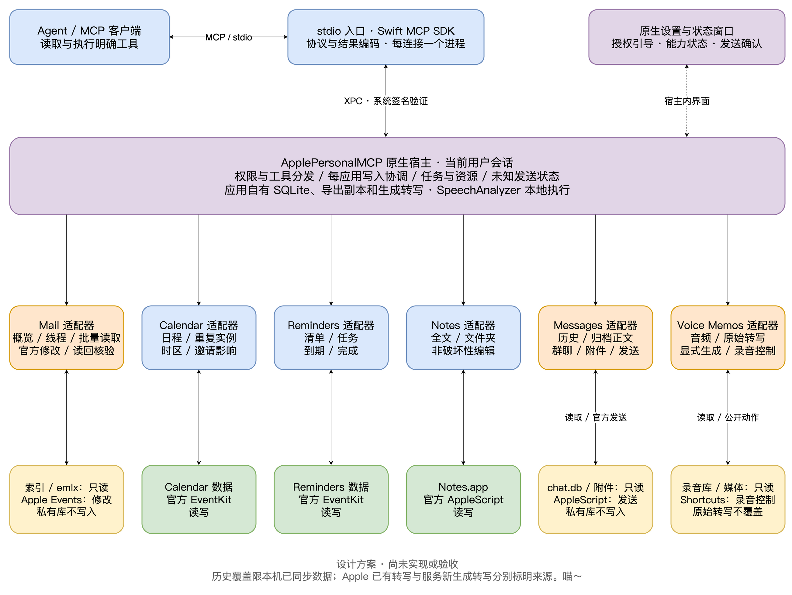

# 六个 macOS 应用的 MCP 整体设计

日期：2026年10月26日。状态：总体设计；当前已实现统一App、多Agent独立授权/并发、Mail核心及六应用读取切片，并在本机验证；其他五应用修改/发送/录音控制等仍待实施。目标环境：Apple silicon、macOS 26及以上；验证机器macOS27 arm64。[最新读取进度](../../../docs/validation/2026-10-26-six-app-reads.md)、[多Agent进度](../../../docs/validation/2026-10-26-multi-agent.md)、[首阶段邮件记录](../../../docs/validation/2026-10-26-framework-mail.md)。后文是完整目标设计，不能当成全部已实现能力。

一个本地 MCP 服务覆盖邮件、日历、提醒事项、备忘录、信息和语音备忘录。公开数据 API 承担可用能力；Mail 大规模查询、信息历史与已有录音、转写使用本地只读解析，应用修改始终走官方通道。所有正文、音频及解析结果默认在本机处理；Agent 收到工具结果后如何使用这些数据，属于其所在客户端的数据处理范围。

## Context

用户明确要求读取信息历史聊天、获取已有语音备忘录音频及转写全文，并允许官方接口不足时只读本地数据。仓库最初为空，没有需要兼容的产品代码。

已核实 Mail、Calendar、Reminders、Notes、Messages 在本机有脚本字典；Calendar 和 Reminders 有 EventKit。Voice Memos 有公开可发现的动作声明，录音实体声明仅见名称、创建时间、时长，不能据此推断音频或转写全文可直接通过动作取得。

本轮尝试以只读方式读取聊天库结构时收到 `authorization denied`，访问 Voice Memos 共享容器时收到 `Operation not permitted`。因此，下面涉及本机私有 schema、原始录音和原始转写的方案仍需要获得系统权限后的真机验证。详细来源见[调研记录](../../../docs/research-evidence.md)。

## Goals / Non-Goals

**目标：**

1. 六个应用各有明确、独立、可发现的 MCP 工具；失败只影响对应能力。
2. 信息能读取当前 Mac 本地可见的历史正文、群聊、回复关系与附件；不能只查询 `message.text` 而漏掉归档正文。
3. 语音备忘录能列出已有录音、取得本地音频、读取已有转写全文；没有原始转写时，允许显式发起独立的本地转写。
4. 邮件、日历、提醒事项和普通备忘录支持日常读取与修改。信息发送、录音控制使用官方通道。
5. 权限、数据可用性、来源、正文完整性、异步任务和未知副作用都有明确返回状态。

**范围外：**

- 读取云端但未同步到当前 Mac 的全部历史、恢复已经删除的数据、恢复撤回消息的旧正文。
- 私有数据库写入、调用 Apple 私有写入 API、直接访问 Apple 内部云接口。
- 远程 HTTP 服务、多用户服务器、root 守护进程、自动摘要或自动创建任务。
- 第一版的向量检索、全库常驻索引、独立消息队列和第三方云语音识别。
- 第一版保证完整编辑 Notes 的所有富内容，以及编辑或删除已发送信息。

## Decisions

### 1. 原生宿主与轻量 stdio 入口

建议交付 `ApplePersonalMCP.app` 和随包的 `apple-personal-mcp` stdio 入口，两者使用 Swift：

| 部件 | 职责 | 生命周期 |
| --- | --- | --- |
| stdio 入口 | 官方 MCP Swift SDK、协议协商、工具和资源编码；把受支持的请求交给原生宿主 | 每个 Agent 连接一个进程；stdout 仅为 MCP，诊断走 stderr |
| 原生宿主 | 系统授权与设置界面、六应用适配器、发送确认、任务和资源文件 | 当前用户会话内单实例；用户能查看状态和退出 |
| 六个适配器 | 把应用原生对象映射成 MCP 数据；不直接管理 Agent 对话 | 宿主进程内的普通 Swift 模块 |
| 本地状态库 | 异步任务、发送操作状态、导出资源清单 | 应用自有 SQLite；不镜像六个应用的全部数据 |

stdio 入口通过用户会话内的 XPC Mach Service 连接宿主。使用 `SMAppService.agent(plistName:)` 注册 app 包内的用户 LaunchAgent，按需启动宿主；宿主与设置窗口复用同一个 app 主程序。注册动作由设置界面执行，服务不要求管理员权限。真实的 TCC 授权归属要通过实际宿主、实际 Agent 启动路径验证，不能假定签名或 app 包装天然解决权限问题。

XPC 两端使用系统代码签名要求验证对端，并限制同一登录用户。签名要求针对 Team ID 与各自 bundle identifier，不绑定某个构建的内容摘要。它保护的是有个人数据权限的跨进程入口；MCP `clientInfo.name` 只用于展示，不能充当身份认证。任何同一用户能启动本项目签名入口的本地进程都在第一版信任范围内；不宣称能区分或防御同一用户已被控制的任意进程。

**选择理由：** 单纯让每个 Agent 启动一个有完整数据权限的 CLI 会减少一个部件，但会把权限诊断、多个客户端的写入协调及录音任务生命周期分散到多个进程。原生宿主集中处理这些实际需求；入口不获得聊天库和录音库的直接访问职责。TypeScript/Python 外壳加 Swift worker 也是可行选择，但这六项能力都依赖 macOS，采用一种语言更容易维护。

SDK 使用官方 Swift SDK，按其实际支持协商协议版本；不能因为官网的最新规格更新，就宣称 SDK 已支持对应全部功能。第一版以普通 tools/resources 完成必要功能，长任务不依赖客户端支持 MCP Tasks 扩展。[SDK 目录](https://modelcontextprotocol.io/docs/sdk)、[Swift SDK](https://github.com/modelcontextprotocol/swift-sdk)

参考 [apple-mail-mcp 的分层](https://github.com/mp-consulting/apple-mail-mcp/blob/4255bef5da220bcad96f4a0a3ea2df98856b4972/Package.swift)，适配器内部把只读数据模型、官方修改和 MCP 结果映射分开，公共运行层只保留六应用确实共用的能力。其 server 和菜单栏 app 分别直接读取 Mail；本项目保留集中宿主，不能把两者当成同一种部署架构。[详细借鉴与取舍](../../../docs/apple-mail-mcp-reference.md)

### 2. 应用读写路线

| 应用 | 读取 | 修改 | 主要限制 |
| --- | --- | --- | --- |
| Mail | Envelope Index、emlx/MIME 只读；官方通道补充 | 官方字典定义的 Apple Events | 本地结构与对象身份需验证；正文和附件可能尚未下载 |
| Calendar | EventKit | EventKit | 账户或日历可能只读；邀请可能产生外部通知 |
| Reminders | EventKit | EventKit | 高级字段只暴露已验证的能力 |
| Notes | 官方 AppleScript | 官方 AppleScript | 锁定笔记、富内容结构与附件能力有限 |
| Messages | `chat.db` 及附件只读 | 官方 AppleScript 发送 | 私有 schema、归档正文、编辑/撤回及同步状态需适配 |
| Voice Memos | `CloudRecordings.db`、原生媒体及转写只读 | 公开快捷指令动作控制录音与播放 | 云端未下载、媒体版本与转写版本可能不同 |

MailKit 用于 Mail 扩展场景，不作为任意邮箱查询的替代接口。Mail 的只读路线用于避免大量脚本查询；Notes 仍优先官方脚本，不因 Mail 可直接读取就推广为所有应用都读私有库。

### 3. 工具接口与数据表达

工具采用明确的应用前缀和操作名，不提供任意 SQL、任意脚本、任意 shell 或任意文件读取工具。以下为第一版计划目录，属于可迭代设计，不冻结为不可修改的接口。

| 模块 | 工具 | 关键参数或结果 |
| --- | --- | --- |
| 服务 | `system_status` | 各应用权限、可用能力、实际检查时间、私有格式支持情况 |
| 服务 | `jobs_get`、`jobs_cancel` | `job_id`，状态、进度、结果、错误；不返回其他会话的临时对象 |
| 服务 | `operations_get` | `operation_id`，发送是否提交、是否未知 |
| 资源 | `assets_read` | `asset_id`、字节范围或文本游标；有界读取应用自有导出 |
| 邮件 | `mail_list_mailboxes`、`mail_search`、`mail_get` | 账户/邮箱、发件人、主题、时间范围、已读状态；全文独立获取 |
| 邮件 | `mail_list_accounts`、`mail_overview`、`mail_get_many`、`mail_get_thread` | 多账户、未读与旗标概览、批量元数据/正文片段、按会话有序读取 |
| 邮件 | `mail_get_attachment` | 消息引用和附件引用，返回资源引用或尚未下载状态 |
| 邮件 | `mail_create_draft`、`mail_update_draft`、`mail_send_draft` | 收件人、正文、附件、草稿引用；发送携带操作 ID |
| 邮件 | `mail_move`、`mail_set_flags`、`mail_undo_change` | 精确消息引用列表、逐项结果、新引用和 change_id；仅恢复已验证的移动/旗标，不撤销发送 |
| 日历 | `calendar_list`、`calendar_search`、`calendar_get` | 日历引用、起止时间、时区、事件实例引用 |
| 日历 | `calendar_create`、`calendar_update`、`calendar_delete` | 事件字段；重复事件修改/删除必须明确 `occurrence` 或 `future` |
| 提醒 | `reminders_list_lists`、`reminders_search`、`reminders_get` | 清单、完成状态、到期范围 |
| 提醒 | `reminders_create`、`reminders_update`、`reminders_complete`、`reminders_delete` | 精确引用、标题、备注、到期/提醒；完成操作使用明确布尔值 |
| 备忘录 | `notes_list_folders`、`notes_search`、`notes_get` | 账户/文件夹、关键词；正文支持纯文本与原始 HTML |
| 备忘录 | `notes_create`、`notes_update`、`notes_move`、`notes_delete` | 更新模式限标题、追加和普通文本替换；删除行为需真机确认 |
| 信息 | `messages_list_chats`、`messages_search`、`messages_get_thread`、`messages_get` | 聊天引用、参与者、时间范围、正文、回复与附件元数据 |
| 信息 | `messages_get_attachment`、`messages_send` | 精确消息/附件或发送目标、服务类型、正文、操作 ID |
| 录音 | `voicememos_list`、`voicememos_get`、`voicememos_get_audio` | 日期、名称、录音引用；音频返回资源而非默认内联 |
| 录音 | `voicememos_get_transcript`、`voicememos_transcribe` | 转写来源选择与文本游标；后者显式启动生成任务 |
| 录音 | `voicememos_record_start`、`voicememos_record_stop`、`voicememos_play` | 通过已配置且已验证的官方快捷指令；未验证时独立标记不可用 |

JSON Schema 表达输入、输出与枚举，Swift 类型表达内部数据。工具返回 `structuredContent`，并保留兼容客户端的文本表示；注解如 `readOnlyHint` 只是工具说明，不代替授权。[MCP 工具规格](https://modelcontextprotocol.io/specification/2025-11-25/server/tools)

所有查询结果含来源、读取时间与覆盖范围。推荐公共字段：

- `id`：优先使用原生标识；需要组合时附账户/数据库上下文。引用不是内容摘要。
- `source`：应用、`official_api` / `local_readonly`、必要的解析器版本。
- `observed_at`、`coverage`：本地可用范围与本次读取时间，不宣称 iCloud 已全部同步。
- `content_status`：`complete` / `partial` / `unavailable`，附缺失原因。
- `next_cursor`、`has_more`：可继续读取的游标；长文本和扫描结果不能静默截断。

查询默认每页 50 项、最多 200 项；正文默认每片最多 16,000 Unicode 标量，游标避免切断编码单元，时间分段转写同时保留分段关系。这些是初始实现限制，可按真实兼容性测试调整。文本分页耗尽表示“读取的该份正文完整”，不表示全库或云端完整。

稳定排序使用原生时间加主键，游标携带查询条件、排序位置和必要的来源上下文。每页使用短读事务；跨页读取不保留长时间 SQLite 事务，返回可能的并发变化说明，不假定翻页期间源数据不变。

时间输入使用带偏移的 ISO 8601；相对日期由 Agent 根据用户意图转为明确区间。默认显示时区为用户系统时区，本机为 Asia/Shanghai。全天日程使用日历日期，提醒事项的无时区到期日保留原始日期语义，不能简单统一成 UTC 零点。

搜索默认只返回摘要和原生跳转入口，全文、原始 HTML 与全部头部按需取得。批量读取最多 200 项且共享总响应预算，不能把单项上限乘以批量数量后全部塞进上下文；每个未完对象保留独立游标。去引用正文属于显式展示模式，标记 `body_view=without_quotes`，不替代完整原文。全文搜索另返回 `search_complete`，它与命中结果的 `has_more` 不同，不能用当前页为空推断候选已全部扫描。

可选 MCP Prompts 提供“邮件阅读与回复草稿”和“录音读取后整理待办”的调用示例，不自动运行、不自动安装全局 Skills。stdio 入口提供 `doctor` 和 `call <已声明工具> <JSON>`，共用宿主的工具实现、授权与结果处理，用于在不启动模型时直接验证实际功能。

### 4. Mail

参照 [MailStore](https://github.com/mp-consulting/apple-mail-mcp/blob/4255bef5da220bcad96f4a0a3ea2df98856b4972/Sources/MailStore/MailStore.swift)，采用“Envelope Index 查询元数据 → emlx/MIME 取得正文和附件 → 官方 Apple Events 修改”的混合路线。发现实际 `~/Library/Mail/V<n>` 数据目录并识别已支持的结构，不固定写死 V10。当前本机读取路径仍需获得权限后验证。

元数据可从已有索引读取，不为正常本地查询启动 Mail；概览整合未读数量、最近摘要和旗标。线程优先使用原生 conversation 关系，批量读取避免重复解析同一邮件。正文处理 emlx 的长度前缀、MIME 多部分、编码、字符集、HTML 和分离存储附件；格式或关联不确定时返回具体错误。无法支持本地布局时可退到官方查询，但要标明 `backend`、性能与覆盖限制，不能隐藏降级。

正文搜索先用原生元数据缩小范围，再有界扫描完整 MIME 正文，并返回扫描游标、已检查范围和 `search_complete`。首版不自动建立持久化正文索引；短期内存缓存采用容量限制与实际源变更失效。扫描可分块继续，不能截取每封前几万字后把它称为完整搜索。

消息引用保存账户、邮箱、索引 ID 和可用的 Message-ID/关键头部。数据库 ROWID 到官方脚本对象的映射必须实测，数值转换不得截断；RFC Message-ID 单独不能作为全局唯一定位。修改前再次核对目标，缺失或重复身份无法唯一定位时拒绝批量修改。移动后返回新引用；读取不得顺带设置已读。

修改优先直接构造官方脚本字典定义的 Apple Events 描述符，避免拼接 AppleScript 文本。Notes、Messages 使用各自字典逐项验证，不能直接复用 Mail 的对象编码。[Apple Events 参考实现](https://github.com/mp-consulting/apple-mail-mcp/blob/4255bef5da220bcad96f4a0a3ea2df98856b4972/Sources/MailAutomation/AppleEvents.swift)

`mail_move` 和 `mail_set_flags` 接收明确引用列表，初始每批最多 50 项；按项串行执行、等待读回后再处理下一项，并受整体时间预算与取消约束。移入废纸篓使用已验证的 move-to-Trash，不调用永久 delete。分别报告 `done`、`unknown`、`failed`、`not_attempted` 和新引用，不能把 Apple Event 无错误当作已经落地。源/目标读回需考虑 Gmail 标签语义；邮箱计数变化不能单独证明某封邮件已移动。发现疑似其他邮件受影响时停止后续修改并报告证据，不自动移动回可能由用户或其他设备修改的邮件。

受限 undo 仅用于已验证的移动与旗标：应用自有记录保存必要的前后状态和原生身份，返回 change_id；恢复前再次核对当前状态仍匹配本服务上次修改，存在后续变化则返回冲突。它不是跨应用事务，不能撤销发送或永久删除。

附件区分元数据、本地可读取和等待 Mail 下载；读取本地已有文件不需要先驱动 Mail。需要触发下载时仅使用公开 Mail 操作，网络不可用返回状态，不把预览或零字节文件当作已取得完整内容。

发送采用“创建/更新草稿 → 读取实际草稿并展示收件人和内容 → 官方 send”。发送成功只证明 Mail 接受或后续本地状态核对通过，不证明邮件到达收件服务器或被阅读。邮件正文 HTML 作为不可信内容处理，不执行脚本或加载远程图片。

### 5. Calendar

复用长期存活的 `EKEventStore`，申请实际需要的访问级别。用户要求查询与修改，因而日历需要 full access；账户只读状态依然必须检查。EventKit 检测到外部变更后使相关缓存失效。

事件区分系列标识与某次 occurrence，引用包含原始开始时间等实例定位信息。重复事件的 update/delete 必填作用范围，映射到 EventKit 的本次或未来事件语义。跨时区、夏令时、全天事件和跨日事件采用原生日历类型处理。

创建/编辑邀请可能向参与者发送通知，应在实际执行前明确告知。禁止直接写 Calendar SQLite 或借私有接口绕过只读账户。

### 6. Reminders

同样使用 EventKit，但提醒事项授权与日历授权分别诊断。清单与任务分开定位；不通过任务标题猜测唯一对象。

第一版覆盖标题、备注、清单、完成状态、到期日期、基础提醒与已验证的重复规则。标签、子任务、附件等未通过公开接口真机验证前不承诺完整覆盖。

使用 `set completed = true/false` 语义而非 toggle，避免重试翻转状态。完成重复任务可能产生下一项，回读实际结果并尊重系统行为；普通修改仅提交指定字段。

### 7. Notes

通过账户、文件夹与 note 标识定位；`notes_get` 同时可提供 `plaintext`、HTML 资源、附件目录及锁定状态。纯文本不声称保留表格、手写或扫描件的全部结构。

追加与替换分别实现。含附件或复杂富内容时，第一版仅支持经测试的非破坏性追加和标题更新，拒绝未经验证的全文替换；普通文本替换也需要显式选择模式。不得读出纯文本再写回，从而悄悄删除原附件。

锁定笔记返回 `locked`，由用户在 Notes 中解锁后再试，不收集密码、不尝试解密。删除必须核实公开接口在当前版本的实际语义；如果不能保证符合用户期望，返回不支持，不能私自写库。

### 8. Messages 历史读取

只读来源为当前用户的 `~/Library/Messages/chat.db` 和数据库关联的附件文件。按实际列与关联关系适配 `message`、`chat`、`handle`、会话关联表和附件关联表；这些是待本机核验的候选结构，不把第三方版本当作本机事实。

处理流程：按聊天/时间筛选候选行 → 关联群聊和参与者 → 解码正文及消息状态 → 取得回复、反应和附件引用 → 有序分页返回。

正文支持普通 `text` 和 `attributedBody` 的 typedstream 归档。不能用“按 UTF-8 转换后取最长字符串”代替解析；不能把 typedstream 当成 NSKeyedArchive。优先评估可单独引入的 Swift TypedStream 实现，例如 Madrid 的对应模块，补齐合成样本并检查许可证，不采用其可能退化为 immutable 的默认数据库访问策略。[Madrid 源项目](https://github.com/mattt/Madrid)

线程中的附件占位符、回复关联、反应、服务消息、编辑/撤回标记应被保留。撤回正文不做取证恢复，不能把已撤回内容作为当前正文；解码失败返回 `unavailable` 与原因。历史编辑版本恢复不在第一版范围内。手机号、邮箱和群聊身份使用精确标识；不因展示名相同就合并参与者。

`messages_search` 必须覆盖解码后的正文，而非仅对 `text LIKE`。第一版先使用有界分批扫描；未扫描完时返回扫描游标、已检查数量和 `search_complete=false`。用户可以继续扫描全部本地历史。无匹配且仍有未扫描数据不能被报告成全库无结果。暂不建立全库索引，避免先复制整份私人聊天再解决同步正确性。

发送走官方 Messages AppleScript。输入为精确 chat 引用，或经确认的目标 handle 和当前可用服务类型；SMS 等能力取决于系统账户与转发配置，不承诺 RCS 或任意群聊创建均受脚本支持。只读数据库行与 AppleScript chat ID 的映射需要验证；无法唯一映射时不能直接发送到“最相似”的聊天。

不通过 SQL 设置已读或编辑消息，读取不应改变 Messages 界面与未读计数。AppleScript send 的返回不是对端送达回执。

### 9. Voice Memos 的已有音频与原始转写

候选来源为共享容器 `Recordings/CloudRecordings.db` 和其关联媒体。优先使用原生录音唯一标识，不能仅依赖标题或文件名。数据库中的字段名、标题优先级、删除状态和媒体格式都需要本机 schema 与界面逐项核对；不得仅枚举目录中的 `.m4a` 就把遗留的已删除文件当作当前录音。

分别返回录音目录状态、音频状态、原始转写状态。音频状态包含 `local`、`not_downloaded`、`missing`、`unsupported`；读取失败或格式未知不能改写为“录音不存在”。尚未下载时可以指引用户在 Voice Memos 中下载，不调用内部 iCloud 接口。

公开实现展示了 `.m4a` 内 `moov → trak → udta → tsrp` 存放 JSON 转写的情况，可作为首个格式适配目标。[原子遍历实现](https://github.com/grmartin/macos-voice-memo-tools/blob/main/src/mp4.js)、[转写结构示例](https://github.com/harryf/voice-memos/blob/main/Sources/voice-memos/Transcript.swift)。这不是 Apple 的格式兼容承诺，也尚未验证这台 Mac 的录音。

解析按容器层级和边界读取，支持合法的 32/64 位 box 长度；不在整份音频内搜索几个字节就认定找到转写，也不把大 `mdat` 载入内存。对 JSON 大小、嵌套和索引设实现上限。按有序 runs 重建全部文字；某段没有时间戳时保留正文并标记时间未知，不能过滤掉它而声称取得全文。多轨、多个候选语言转写分别返回，不把它们无条件拼成一篇重复文本。

对于编辑过的录音，要区分当前有效音频和原始素材。原生格式可能是 `.m4a`、`.qta` 或相关资源组合；默认导出当前有效表示。可通过 AVFoundation 正确读取时生成标准媒体副本；不能可靠展平时返回 `unsupported_media`，不能直接换扩展名或把旧原始音轨说成当前录音。转写与当前音频的对应关系不明时标记 `alignment=unverified`，不声称时间戳与剪辑后音频完全一致。

`voicememos_get_transcript(source=original)` 为默认读取：

1. 有原始转写：返回完整文字、可用时间分段、locale、`origin=apple_existing` 和正文分页。
2. 明确没有转写：返回 `not_present`；它不同于权限不足、音频未下载或格式解析失败。
3. 格式无法解析：返回 `unsupported_format` 或 `decode_failed`，不自动换成新生成文本。

`source=generated` 只取已完成的服务生成结果；`source=best_available` 优先原始转写，其次已有生成结果，并明确实际来源。读取工具本身不隐式发起重新转写。

独立工具 `voicememos_transcribe` 使用 Apple 的 SpeechAnalyzer / SpeechTranscriber 和 AVFoundation，对当前音频生成新转写，返回 `origin=generated_on_device`、语言和执行信息。先检查设备/语言支持与模型资源；模型未安装时提示下载需求，音频不因下载模型而被上传。没有可用本地模型时返回不支持，不悄悄退到云端。Apple 的新 API 支持长音频处理，但不能由此推断所有语言和设备都可用。[Apple SpeechAnalyzer 介绍](https://developer.apple.com/videos/play/wwdc2025/277/)

生成文本只写应用自有目录，不写回 Voice Memos。重新运行是显式任务，保留与原始转写的区别；不承诺生成结果逐字等同于 Voice Memos 界面显示。

### 10. Voice Memos 的公开动作

录音开始、停止、播放使用固定、可审阅的本地快捷指令，经官方 `shortcuts run` 运行。设置界面引导安装和验证，不执行任意 Agent 提交的 shortcut 名称或工作流。[Apple 命令行说明](https://support.apple.com/en-au/guide/shortcuts-mac/apd455c82f02/mac)

动作声明不等于已经能无交互调用。需要分别验证后台/前台行为、参数输入、输出、麦克风授权，以及快捷指令实体标识和本地数据库标识的关联。不能通过“最新一条录音”猜测本次操作结果；并发录音或 iCloud 同步会造成误匹配。拿不到可靠关联时返回动作已提交和待用户确认状态，不伪造录音 ID。

停止录音仅对明确由本服务启动且能确认仍在进行的录音会话执行。无法确认时交由用户在系统应用中操作。即使录音控制暂不可用，已有录音、音频与转写读取仍可独立交付。

### 11. 本地只读与 SQLite 一致性

读取源库使用 `SQLITE_OPEN_READONLY` / `mode=ro`，不启用 ORM 自动迁移、不创建缺失的数据库。查询使用参数绑定，读取事务保持短小，不执行源库 checkpoint、VACUUM、DDL 或写入 PRAGMA。

WAL 中可能包含最新提交，必须让 SQLite 正常读取可用的 WAL。对正在变化的真实数据库不使用 `immutable=1` 来绕过访问限制；它可能忽略变化或 WAL，从而让新聊天消失。只读 WAL 打开失败时返回具体状态，不临时换成读写打开。若 SQLite 需要创建辅助文件，第一版宁可返回不可读取，也不授权适配器创建源目录文件。应在无源目录写权限、已存在 WAL/SHM 的测试样本上验证实际行为。[SQLite WAL 文档](https://sqlite.org/wal.html)

确有大批处理需要副本时，通过正常只读连接和 SQLite backup API 生成应用目录内的一致副本，并明确 `snapshot_at`。不能在源库活动时依次复制 DB、WAL、SHM 并宣称得到一致快照；当前设计默认直接短事务查询，不自动保存整库副本。[SQLite Backup API](https://sqlite.org/backup.html)

用实际存在的表列和必要值类型识别支持的布局；只支持已验证的适配路径，遇到不认识的布局报告 `unsupported_schema`。无需新增 schema 摘要或版本冻结文件；Git、适配器版本、结构检查、合成样本和真机回归负责维护兼容性。

### 12. 权限与数据边界

| 权限/条件 | 用途 | 诊断方式 |
| --- | --- | --- |
| Calendar full access | 查询与修改日程 | EventKit 授权状态与实际查询 |
| Reminders full access | 查询与修改任务 | 独立授权状态与实际查询 |
| Automation：Mail、Notes、Messages | 应用脚本读写 | 分应用授权诊断；拒绝不循环弹窗 |
| Full Disk Access / 容器访问 | Mail 索引/邮件、聊天库、录音库及媒体 | 宿主真实只读打开，区分权限拒绝与不存在 |
| 麦克风及 Voice Memos/Shortcuts 条件 | 新录音控制 | 由实际执行录音的应用请求，不为读取已有录音强行申请 |
| Speech 资源与运行条件 | 显式本地生成转写 | 实际 API 支持检查；按所选 API 要求申请权限 |
| 后台项目状态 | 用户会话宿主按需启动 | SMAppService 状态与实际 XPC 连接 |

正式 app 采用 Developer ID 签名、公证和 Hardened Runtime，配置所需的 usage descriptions 与 Apple Events entitlement；第一版不启用 App Sandbox。签名不等于获得隐私权限；FDA 由用户在系统设置授予，服务不能自行授予、重置或绕过。

`system_status` 区分 `ready`、`needs_permission`、`not_configured`、`unsupported`、`temporarily_unavailable`。它不扫描正文，不以权限自检成功替代功能实测。工具实际执行时仍处理权限撤销。

`doctor` 与状态工具共用检查，分别报告读取和修改通道、实际宿主路径、app/入口版本及待重启客户端；对无法由公开信息确定的隐私授权归属标记 `inferred`，通过真实访问失败确认，不复制参考项目的未公开责任进程查询。原生菜单栏/设置窗口按六应用展示状态、运行任务、最近活动和待确认发送；首版提供可复制的客户端 stdio 配置，不自动覆盖已有设置。

`--read-only` 在工具发现时隐藏应用修改工具，在实际分发时再次拒绝旧缓存中的修改调用；保留受限的资源导出，显式生成转写和录音控制不在此模式中开放。它限制应用操作，不能宣称整个进程不产生缓存或任务元数据。

附件路径来自已解析的原生记录，并经允许的应用数据根目录与实际文件身份检查；Agent 不能通过构造资源 ID、软链接或相对路径读取任意文件。邮件附件导入只接受用户明确选择或配置允许目录中的文件。系统原生引用可在服务内部保留，默认不把私有库完整路径发送给 Agent。

应用内容视为数据，不能因为邮件、笔记或转写里出现指令就执行 shell 或发送消息。这一处理降低服务自身被内容驱动的风险，不能保证上层 Agent 永远不会误用已读取内容；上层客户端仍需遵守用户授权。

### 13. 普通修改与外部副作用

正常读取不重复确认。普通可恢复修改按用户已给出的请求执行；对象 ID、权限和指定字段是主要工程约束。修改前重新取得当前对象，对已删除、只读或明显过时的目标返回明确错误，不添加通用审批流水线。

邮件发送、信息发送、影响他人的日历邀请，以及无法恢复的删除属于实际外部或不可逆边界。默认由原生宿主展示实际目标和内容供用户确认；允许用户在设置中明确授予限定会话/目标的持续授权，已有授权范围内不重复询问。工具参数中的 `confirmed=true` 不能自行证明用户已授权。

发送操作使用客户端预先生成的 `operation_id`，应用自有 SQLite 对其设唯一约束，正常事务记录 `prepared → submitting → submitted / unknown / failed`。重复相同 ID 只返回已有执行记录，明确标记未重新执行，不把第二次请求视为新发送；ID 不能用于在同一记录上修改目标或内容。记录保留必要的对象引用、阶段与时间，不记录正文日志。

跨 Apple 应用与本地状态库没有统一事务。崩溃、超时或取消发生在提交后但回执前时标记 `unknown`，不能自动重发，也不把它说成失败。可通过已发送邮箱/本地信息记录辅助核对，但不能靠相同文本匹配就证明唯一送达，更不承诺 exactly-once。只有操作状态确定失败且重新取得授权时才启动新的发送。

工具取消或 Agent 断开不能撤回已经执行的 send。它只停止未开始的工作，并返回已发生的效果；撤销只能使用应用实际提供的操作。

### 14. 资源、任务与存储

音频和附件默认返回 `asset_id`、MIME、长度和 `apple-personal-mcp://assets/...` 资源 URI。宿主只在应用自有 Exports 目录生成副本，UUID 文件名避免暴露标题；不会向任意目标路径写文件。原生 `.qta` 保留其实际类型，不能声称它是 M4A。

兼容 resources 的客户端可读取受大小限制的内容；较大二进制用 `assets_read` 分块读取，初始每块最多 512 KiB。可信的同机客户端也可请求应用自有导出路径。资源的可达性和有效期必须随结果返回，不能只给出客户端无法解析的 URI。

任务包括生成转写、需要转换的大音频和长扫描。启动后立即返回 job ID，通过普通工具获取 `queued / running / succeeded / failed / cancelled / interrupted`。每个用户宿主初始只并行执行一个重型语音任务，避免资源争用；读操作可并行，官方自动化写操作按应用串行执行。

转写显式任务在 Agent 断开后可继续；重启后未完成任务标记 interrupted，不假装支持断点恢复。取消清理该任务临时文件，已产生的用户应用效果仍需报告。导出、转写完成后能取得完整结果，而非只保留一个短预览。

应用自有目录建议如下，采用用户专属文件权限：

| 位置 | 内容 | 初始保留策略 |
| --- | --- | --- |
| `~/Library/Application Support/ApplePersonalMCP/state.sqlite` | job、操作、资源元数据 | 已完成 job/操作元数据保留 30 天；删除记录后不再承诺识别旧 operation ID |
| `.../Exports/` | 录音和附件副本 | 默认 24 小时；到期可由 Agent 明确重取 |
| `.../Transcripts/` | 服务生成的文字与分段 | 默认 30 天；用户可立即清理 |
| `.../Work/` | 正在转换的临时文件 | 任务结束/取消清理；重启清理遗留 |

状态库、临时文件和生成转写不属于“只读 Apple 数据”承诺的禁止写入范围；源应用文件才是保护对象。设置界面展示这些衍生副本，提供清理按钮。缓存有效性以原生 ID、文件身份、大小、修改时间及媒体修订字段检查；信号不足时重新读取或标记待核对，不默认新增内容 Hash。

日志只记录工具名、耗时、状态码和必要操作引用，默认不记录收件人、消息正文、转写、附件内容和音频。服务不自动把结果上传给其他模型，也不生成隐藏的个人数据调试包。

活动状态在调用开始时即记录，执行中区分等待应用串行队列、官方调用与读回核验，最后记录成功、部分完成、失败或未知，并带 app/入口构建版本。这样超时或崩溃后仍可知道请求是否进入执行；不引入事件溯源。临时活动记录只保留必要元数据，不保存请求正文或完整参数。

### 15. 错误与不完整结果

| 类别 | 例子 | 返回行为 |
| --- | --- | --- |
| 权限 | `permission_denied`、`locked` | 说明具体应用和恢复步骤；不当作空结果 |
| 配置 | `not_configured`、`app_unavailable` | 保留其余应用的可用性 |
| 数据 | `not_found`、`not_downloaded`、`source_changed` | 只说明当前本地状态；不伪造云端结论 |
| 兼容性 | `unsupported_schema`、`unsupported_format`、`decode_failed` | 不写库修复、不改用有损乱码猜测 |
| 扫描 | `partial`、`search_complete=false` | 返回已得结果、覆盖范围与继续游标 |
| 执行 | `cancelled`、`timeout`、`effect_unknown` | 区分尚未执行与副作用未知；发送不自动重试 |

工具执行失败以 MCP tool error 返回，并保留结构化错误码；协议级错误与工具错误分开。合法的零结果仍为成功，权限拒绝或解码失败不能伪装成零结果。

## Risks / Trade-offs

- **私有格式随系统更新变化** → 用合成样本和实际只读样本校验；只对已验证布局启用解析。未知字段可保留原始元数据，未知核心布局明确拒绝。
- **FDA/TCC 的实际授权归属不同于预期** → 最早实现一个签名宿主探针，从真实 Agent 入口启动后验证；不要求本轮变更任何隐私设置。
- **部分历史或录音未同步** → 明确 local coverage；展示未下载状态，交由系统应用完成同步。
- **旧转写与剪辑后音频不对齐** → 分开返回来源与对应关系；必要时显式生成新转写。
- **多应用修改不能原子回滚** → 每步单独报告结果，停止后续步骤，保留已经完成的效果，不承诺跨应用事务。
- **大量聊天初次全文搜索较慢** → 分批扫描、异步任务、可继续游标；通过实测决定是否值得增加应用自有全文索引。
- **原生宿主比单个 CLI 多一处 IPC** → 将 IPC 限于固定操作及数据编码，复用系统 XPC 和签名验证，不引入网络服务或通用插件执行层。

## Migration Plan

这是新项目，没有用户数据迁移。按下面顺序实施，所有阶段都必须运行真实功能：

| 阶段 | 工作 | 验证结果 |
| --- | --- | --- |
| 1 | 签名宿主、stdio/XPC 最小连接、权限探针；读取源库 schema 与一组用户选定样本 | 实际 Agent 启动路径上可读；拒绝权限时有正确状态；仅查看设置不算通过 |
| 2 | Mail 索引/emlx 读取和官方降级，Calendar/Reminders/Notes 读取，Messages 正文，Voice Memos 音频与原始转写 | 六应用各完成真实读取；长正文可重组；Mail 关闭时本地读取；本地 UI 对照；未覆盖格式明确记录 |
| 3 | 官方写操作、草稿发送、信息发送、录音快捷指令、音频转换与生成转写 | 用户指定测试对象和收件人；真实生效；未知发送不重复；录音关联准确 |
| 4 | 客户端兼容、权限撤销、并发/崩溃、签名公证与卸载 | 至少两个独立 MCP 客户端验证；实际升级/重启后重测隐私归属 |

退出方案：停止宿主并取消后台项目注册，删除客户端 MCP 配置；应用自有衍生文件由用户选择保留或清理。卸载不修改聊天、录音、邮件、笔记或系统隐私数据库。已发生的发送和用户应用修改不因卸载而消失。

## Open Questions

这些是实施时要测出的事实，不需要用户重新确认已经给出的六应用范围或只读访问授权：

1. macOS 27 本机聊天 schema、typedstream 变体、编辑与附件标记的实际布局。
2. 本机录音标题/删除字段、`.qta` 等媒体构成、原始 `tsrp` 及其他转写格式、剪辑后的对应关系。
3. 三个 Voice Memos 快捷指令的交互行为与稳定对象映射；无法可靠自动化的动作应明确缩小能力。
4. 签名宿主以用户 LaunchAgent 运行时，Calendar、Automation、FDA 与容器授权的实际归属。
5. 原始语音转写与生成语音转写在中文、混合语言、长会议和编辑音频上的差异，以及 SpeechTranscriber 当前可用语言与设备支持。
6. Notes 删除与富内容追加、Mail 附件下载、Messages 服务类型，在目标版本上的实际结果。
7. 本机 Mail 索引结构、emlx/分离附件布局、索引 ID 到官方对象的映射、Gmail 标签与移动语义，以及冷/热查询的实际延迟和响应大小。参考项目的性能数字不作为本项目结果。

更细的可执行要求见本变更的八个 `specs/*/spec.md`；尚未实施的步骤见 [tasks.md](tasks.md)。没有产品测试结果可以从文档校验或架构图导出推导出来。

喵～
